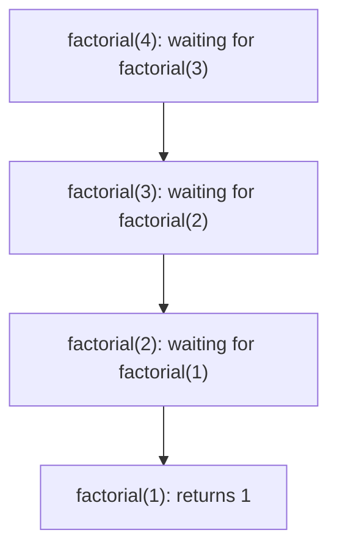
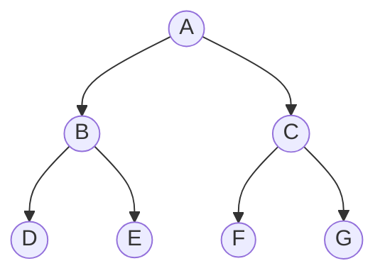

# Week 6 Lecture Notes — Recursion and Binary Trees

> October 13, 2026 · Source lineage: previous recursion and binary-tree notes,
> the 2025 Week 3–4 notebooks, and the instructor-provided *From C to Assembly*
> handout

> Python bridge: [Python Contrast Companion for Week 6](week06_python_companion.md)

---

## Student route

- **Core:** identify a base case and decreasing measure, trace stack frames,
  perform the three tree traversals, reconstruct from inorder/postorder, and
  destroy owned subtrees in postorder.
- **Practice:** complete the [Week 6 exercise](lecture_exercises/week06_ex.md)
  before comparing with [the complete example](examples.c).
- **Supporting ideas:** Hanoi, backtracking, ambiguity counting, and stack-limit
  analysis reinforce the recursion model; first master the small tree trace.
- **Python bridge:** use the companion when manual allocation obscures the
  recursive algorithm shared by both languages.

---

## Learning objectives

By the end of this lecture, you should be able to:

1. Write a recursive function from a decreasing problem measure.
2. Trace recursive calls and stack frames.
3. Represent and traverse a binary tree.
4. Build and destroy an owning tree safely.
5. Relate tree shape to time and stack-space complexity.
6. Explain when traversal pairs determine a unique tree and when multiple
   interpretations must be validated or counted.
7. Structure a small exhaustive search as choose, recurse, validate, and undo.

---

## Three-hour plan

| Hour | Main question | In-class production |
|------|---------------|---------------------|
| 1 | How do recursive contracts guarantee progress? | Trace recursion and a choose/recurse/undo search |
| 2 | How does tree shape determine traversal order? | Draw trees and derive traversal/query functions |
| 3 | What can traversal sequences prove about a tree? | Reconstruct, validate, and compare possible interpretations |

Each hour alternates explanation, hand traces, live coding, and short practice.
Exercises labelled **Core live** belong to the planned classroom route.
Exercises labelled **Extension** may move to the lab or independent study when
the class needs more time for the core recursion and tree traces.

### Inline practice routine

For each **Try it now** activity:

1. predict the return value, visit order, tree shape, or diagnostic before
   running code;
2. write the recursive contract, base case, and decreasing measure when the
   activity introduces a recursive function;
3. draw one stack or tree trace rather than relying only on final output;
4. compile valid C with `-std=c17 -Wall -Wextra -Wpedantic`; and
5. compare the result with the hidden solution only after making an attempt.

Only the question is visible initially. Expand **Reveal solution** to see an
expected output, completed trace, or an explanation that the example has no
run-time output. Exact memory addresses and sanitizer wording are
machine-dependent and are never part of a required answer.

- **Core live:** part of the planned in-class route.
- **Extension:** extra practice for a break, lab, or later review.

The core-live activities total about 19 minutes in Hour 1, 16 minutes in Hour
2, and 20 minutes in Hour 3. The remaining time is for explanation, live
coding, questions, transitions, and a short break.

---

## Hour 1 — Recursive reasoning and the call stack

> **Hour 1 route:** [A recursive proof becomes a recursive program](#1-a-recursive-proof-becomes-a-recursive-program)
> → [Stack frames](#2-stack-frames)
> → [Euclid's algorithm](#euclids-algorithm)
> → [Fast exponentiation](#fast-exponentiation)
> → [Recursion versus iteration](#recursion-versus-iteration)
> → [Quick comparison](#quick-comparison)
> → [Classic divide-and-recombine example: Towers of Hanoi](#classic-divide-and-recombine-example-towers-of-hanoi)
> → [Backtracking: choose, recurse, undo](#backtracking-choose-recurse-undo)
> → [Classic backtracking example: N queens](#classic-backtracking-example-n-queens)
> → [checkpoint](#hour-1-checkpoint)

### 1. A recursive proof becomes a recursive program

A correct recursive design needs:

1. a **contract** for what the function returns;
2. one or more **base cases** solved directly;
3. a recursive case using smaller instances;
4. a **decreasing measure** that guarantees reaching a base case.

```c
unsigned long long factorial(unsigned int n) {
  if (n <= 1) return 1;
  return n * factorial(n - 1);
}
```

The measure `n` decreases. This function is structurally correct but its result
still overflows quickly; recursion does not remove numeric limits.

The function itself performs no input or output. A caller such as
`printf("%llu\n", factorial(5));` prints `120` while the value remains
representable.

#### Try it now [Core live] — complete the recursive contract (3 minutes)

For `factorial(5)`, write the contract, base case, decreasing measure, maximum
number of active calls, and returned value. Then predict the output of the
caller above.

<details>
<summary>Reveal solution</summary>

- Contract: for the demonstrated nonnegative input, return `n!` when the result
  is representable as `unsigned long long`.
- Base case: `n <= 1`, returning `1`.
- Decreasing measure: `n`; the recursive call receives `n - 1`.
- Maximum active calls for `factorial(5)`: five, for arguments `5` through `1`.
- Unwinding values: `1`, `2`, `6`, `24`, `120`.

**Expected output:**

```text
120
```

</details>

---

### 2. Stack frames

Each active call has its own parameters, local variables, and return location.
Tracing `factorial(4)`:

```text
factorial(4)
  4 * factorial(3)
        3 * factorial(2)
              2 * factorial(1)
                    1
```

After the base case, calls finish in reverse order. Recursion depth consumes
stack space. A missing base case, a non-decreasing argument, or a valid but very
deep input can exhaust the process stack. In an online judge this normally
appears as **Runtime Error** (often a segmentation fault), not as Python's
`RecursionError`. C does not provide a portable recursion-depth exception that
you can catch.



Each unfinished box is one active call. The boxes disappear in the reverse
order as return values move upward.

#### Try it now [Core live] — distinguish calling from returning (3 minutes)

Trace `factorial(4)`. Immediately before the base case returns, list the active
arguments from the oldest frame to the newest. Then list the multiplication
results in the order in which calls return.

<details>
<summary>Reveal solution</summary>

Immediately before the base case returns, the active arguments are:

```text
4 -> 3 -> 2 -> 1
```

Return and multiplication proceed in the opposite direction:

```text
factorial(1) = 1
factorial(2) = 2 * 1  = 2
factorial(3) = 3 * 2  = 6
factorial(4) = 4 * 6  = 24
```

This is a call trace, not program output; the function prints nothing by
itself.

</details>

<details>
<summary>Optional machine-code lens: calls, frames, and the ABI</summary>

At the machine level, a call must preserve enough information to resume the
caller. A platform's application binary interface (ABI) specifies where
arguments and return values go, which registers a function must preserve, stack
alignment, and related conventions. A traditional 32-bit x86 trace may show:

- a `call` that records a return address and transfers control;
- a prologue that saves a frame pointer and reserves local storage;
- parameters and locals addressed relative to that frame pointer;
- a return value placed in a designated register; and
- an epilogue followed by `ret` to resume the caller.

None of those exact instruction sequences is required by C. Modern ABIs often
pass initial arguments in registers; a compiler can omit the frame pointer,
inline a function, reuse storage, or eliminate a call. Stack growth toward lower
addresses is common on x86 but is also an implementation detail.

Recursion creates one distinct source-level function activation per unfinished
call. It commonly creates repeated machine stack frames, which explains how
parameters and locals from different calls remain distinct and why excessive
depth can overflow finite stack space. Tail-call elimination can sometimes
reuse a frame, but C does not guarantee it.

Compile a small recursive sum with `-O0 -S` and `-O2 -S`. Week 4 explains that
`-S` produces assembly, while `-O0` disables optimization; `-O2` enables a
substantial set of optimizations. At each level, mark the base-case branch,
recursive call or replacement loop, returned value, and evidence that the
argument progresses. Do not make correctness depend on optimized recursion
being replaced with iteration.

</details>

<details>
<summary>Optional contrast examples: Euclid's algorithm and fast exponentiation</summary>

---

### Euclid's algorithm

```c
int gcd(int a, int b) {
  if (b == 0) return a < 0 ? -a : a;
  return gcd(b, a % b);
}
```

Contract: for supported inputs, return the nonnegative greatest common divisor.
The absolute value of the second argument decreases after reduction. Discuss
the `INT_MIN` limitation and decide whether the production interface should use
a wider type or reject that case.

---

### Fast exponentiation

Fast exponentiation reduces the exponent by half instead of by one:

```c
long long power(long long base, unsigned int exponent) {
  if (exponent == 0) return 1;
  long long half = power(base, exponent / 2);
  if (exponent % 2 == 0) return half * half;
  return half * half * base;
}
```

The decreasing measure is `exponent`; depth is O(log exponent). Arithmetic may
still overflow. Trace `power(3, 5)` and draw when multiplication happens on the
unwinding path.

</details>

---

### Recursion versus iteration

Use recursion when it exposes the structure of the proof or data. Use iteration
when the state transition is simpler and deep recursion risks the stack. Tail
calls are not guaranteed to be optimized by C, so rewriting a linear recursive
loop may be necessary for unbounded input.

---

### Quick comparison

For Fibonacci, binary search, and linked-list length, identify the problem
measure, number of recursive calls, maximum depth, and overlapping subproblems.
Explain why naive Fibonacci is exponential while the other two need not be.

---

### Classic divide-and-recombine example: Towers of Hanoi

> **Supporting recursion example:** use Hanoi to trace recursive decomposition;
> reproducing the complete solution from memory is not a C-language objective.

To move `n` disks from peg `A` to peg `C` using peg `B`:

1. move the top `n - 1` disks from `A` to `B`;
2. move the largest disk from `A` to `C`;
3. move the `n - 1` disks from `B` to `C`.

```c
#include <stdio.h>

void hanoi(unsigned int n, char from, char temporary, char to) {
  if (n == 0) return;
  hanoi(n - 1, from, to, temporary);
  printf("move disk %u: %c -> %c\n", n, from, to);
  hanoi(n - 1, temporary, from, to);
}
```

The measure `n` decreases, but each non-base call creates two recursive calls.
The number of moves satisfies `T(n) = 2T(n - 1) + 1 = 2^n - 1`. Trace `n = 3`
before running it and check that no larger disk is ever placed on a smaller one.

Calling `hanoi(2, 'A', 'B', 'C')` produces this deterministic output:

```text
move disk 1: A -> B
move disk 2: A -> C
move disk 1: B -> C
```

#### Try it now [Core live] — preserve parameter roles (4 minutes)

Without running the program, write the seven output lines for
`hanoi(3, 'A', 'B', 'C')`. Underline the single move of disk `3`, and explain
why the two recursive calls exchange different peg roles.

<details>
<summary>Reveal solution</summary>

```text
move disk 1: A -> C
move disk 2: A -> B
move disk 1: C -> B
move disk 3: A -> C
move disk 1: B -> A
move disk 2: B -> C
move disk 1: A -> C
```

Before disk `3` moves, peg `C` is temporary and peg `B` is the destination for
the top two disks. After disk `3` moves, peg `A` becomes temporary and peg `C`
is the destination. The two calls therefore represent different subproblems,
even though both use `n - 1`.

</details>

---

### Backtracking: choose, recurse, undo

> **Supporting algorithmic pattern:** backtracking extends recursive reasoning.
> The required skill is to identify the choice, progress measure, base case,
> and undo step; N-Queens is the worked illustration.

Some small search spaces are naturally described by a sequence of decisions.
A backtracking function maintains a partial answer, chooses one permitted next
step, recurses, and then **undoes** that step before trying another choice. The
undo step restores the caller's invariant; omitting it silently removes valid
branches.

---

### Classic backtracking example: N queens

Place one queen in each row of an `n × n` chessboard so that no two queens share
a column or diagonal. A recursive call represents “rows `0` through `row - 1`
are already valid.” For every column in the current row:

1. reject it immediately if the column or either diagonal is occupied;
2. mark the three occupied lines;
3. recurse on `row + 1`;
4. unmark the three lines before trying the next column.

```text
choose a safe column
    -> mark column and diagonals
        -> solve the next row
    -> undo all three marks
```

The base case `row == n` means one complete placement was found. This is more
efficient than generating all `n!` row-to-column permutations and validating
only at the end because unsafe partial boards are pruned immediately. For the
four-queen problem, draw the search branches for the first queen in columns `0`
and `1`, and identify the first point at which each impossible branch stops.

Complete search is appropriate only when the published bound is small. Estimate
the largest search tree before coding, and look for safe early rejection rules.

Keep the search state and validation rules explicit. Pass the current queen
positions, occupied-line sets, and result accumulator as parameters or group
them in a context structure. Hidden mutable `static` work buffers make repeated
calls and tests harder to reason about.

The pseudocode describes state transitions and produces no output by itself.
A complete four-queen counter should report `2`; that result is useful only
after the choose/undo invariant has been traced.

#### Try it now [Core live] — find the missing undo (4 minutes)

Suppose a four-queen search marks a column and both diagonals before recursion
but unmarks only the column afterward. What invariant is broken, and what kind
of wrong result should you expect?

<details>
<summary>Reveal solution</summary>

On return, the caller requires all three occupied-line sets to describe exactly
the queens in earlier rows. Leaving either diagonal marked records a queen that
no longer exists in the partial board. Later legal positions are then rejected,
so the search can undercount solutions—often reporting `0` or `1` instead of
the correct four-queen count:

```text
2
```

The precise wrong count depends on which stale mark remains and the search
order; the invariant violation, not one accidental output, identifies the bug.

</details>

---

### Hour 1 checkpoint

#### Try it now [Core live] — compare recursive shapes (5 minutes)

For factorial, Towers of Hanoi, and N queens, state the contract, base case,
decreasing measure, maximum depth, and number of recursive calls per non-base
case. Then explain which one uses “undo” and why the other two do not.

<details>
<summary>Reveal solution</summary>

| Example | Base case | Decreasing measure | Maximum depth | Recursive calls per non-base case |
|---------|-----------|--------------------|---------------|-----------------------------------|
| factorial | `n <= 1` | `n` | O(n) | 1 |
| Hanoi | `n == 0` | `n` | O(n) | 2 |
| N queens | `row == n` | `n - row` | O(n) | one for each currently safe column |

Factorial and Hanoi do not mutate shared search choices; their local parameters
fully describe each subproblem. N queens marks shared occupancy state, so every
recursive branch must undo those marks before its sibling branch begins. This
checkpoint has no program output; the table and invariant explanation are the
deliverables.

</details>

---

## Hour 2 — Recursive data and traversal design

> **Hour 2 route:** [Recursion follows recursive data](#3-recursion-follows-recursive-data)
> → [Traversal orders](#traversal-orders)
> → [Aggregate queries](#4-aggregate-queries)
> → [Derive, do not memorize, traversal order](#derive-do-not-memorize-traversal-order)
> → [board exercise](#hour-2-board-exercise)

### 3. Recursion follows recursive data

```c
struct TreeNode {
  int value;
  struct TreeNode* left;
  struct TreeNode* right;
};
```

A tree is either empty (`NULL`) or a node with two smaller trees. The data
definition suggests the program structure.

#### Try it now [Core live] — expand one recursive definition (3 minutes)

For a node whose left child is a leaf and whose right child is `NULL`, draw both
nodes and all four child-pointer fields. How many nonempty recursive tree
objects and how many empty recursive tree objects are present?

<details>
<summary>Reveal solution</summary>

```text
root
├─ left -> leaf
│          ├─ left  -> NULL
│          └─ right -> NULL
└─ right -> NULL
```

There are two nonempty trees (the root tree and the leaf subtree) and three
empty trees (the root's right subtree and the leaf's two children). This is a
representation trace; it has no program output.

</details>

---

### Traversal orders

Use this tree for the first trace:



```c
#include <stddef.h>
#include <stdio.h>

void preorder(const struct TreeNode* node) {
  if (node == NULL) return;
  printf("%d ", node->value);
  preorder(node->left);
  preorder(node->right);
}

void inorder(const struct TreeNode* node) {
  if (node == NULL) return;
  inorder(node->left);
  printf("%d ", node->value);
  inorder(node->right);
}

void postorder(const struct TreeNode* node) {
  if (node == NULL) return;
  postorder(node->left);
  postorder(node->right);
  printf("%d ", node->value);
}
```

- Preorder handles the root before its children.
- Inorder handles the root between left and right.
- Postorder handles children before the root.

The appropriate order follows the task, not a memorized ranking.

For the pictured tree:

| Order | Visit sequence | How to read it |
|-------|----------------|----------------|
| Preorder | `A B D E C F G` | root, then left subtree, then right subtree |
| Inorder | `D B E A F C G` | left subtree, root, right subtree |
| Postorder | `D E B F G C A` | left subtree, right subtree, root |

Point to the line containing `printf` in each function: its position relative
to the two recursive calls exactly matches the order's definition.

#### Try it now [Core live] — move one visit operation (4 minutes)

For the pictured seven-node tree, predict the three output lines produced when
each traversal is followed by `putchar('\n')`. Then move only the `printf` line
in `preorder` to obtain inorder and postorder behavior.

<details>
<summary>Reveal solution</summary>

The `TreeNode` stores `int`, so use values `1` through `7` in the positions
shown as `A` through `G`. The output is:

```text
1 2 4 5 3 6 7
4 2 5 1 6 3 7
4 5 2 6 7 3 1
```

Placing the visit before both recursive calls gives preorder, between them gives
inorder, and after both gives postorder. The rendered block omits the final
formatting space that `printf("%d ", node->value)` emits before each newline.

</details>

---

### 4. Aggregate queries

```c
#include <stddef.h>

size_t tree_size(const struct TreeNode* node) {
  if (node == NULL) return 0;
  return 1 + tree_size(node->left) + tree_size(node->right);
}

int tree_height(const struct TreeNode* node) {
  if (node == NULL) return -1; /* height measured in edges */
  int left = tree_height(node->left);
  int right = tree_height(node->right);
  return 1 + (left > right ? left : right);
}
```

Define conventions explicitly. Some books call an empty tree height `0` and a
leaf height `1`; this note measures edges, so they are `-1` and `0`.

#### Try it now [Core live] — combine subtree results (4 minutes)

Using the pictured seven-node perfect tree, compute every returned value of
`tree_size` and `tree_height` from the leaves upward. Then predict the output of:

```c
printf("size=%zu height=%d\n", tree_size(root), tree_height(root));
```

<details>
<summary>Reveal solution</summary>

Every `NULL` size call returns `0`; each leaf therefore returns size `1`, each
two-child internal subtree returns `3`, and the root returns `7`. Every `NULL`
height call returns `-1`; each leaf returns `0`, its parent returns `1`, and the
root returns `2`.

```text
size=7 height=2
```

</details>

---

### Derive, do not memorize, traversal order

Choose the moment to process the root:

- print an outline before children → preorder;
- print BST values in order → inorder;
- compute a directory's size after child sizes → postorder;
- release a resource after owned children → postorder;

Week 7 applies the same idea to expression trees. Moving evaluation there lets
us first establish traversal on ordinary binary trees, then add operator-node
invariants when the compiler pipeline is introduced.

---

### Hour 2 board exercise

#### Try it now [Core live] — reconstruct from two orders (5 minutes)

For a seven-node tree, derive preorder, inorder, and postorder sequences. Then
work backward: given preorder and inorder with unique labels, circle the root,
partition both sequences, and repeat on each subtree. Include an empty subtree
and a one-child node rather than using only a perfect tree.

Use this concrete pair for the backward trace:

```text
preorder:  A B D C E
inorder:   D B A E C
```

<details>
<summary>Reveal solution</summary>

`A` is the preorder root. In inorder, `D B` is its left segment and `E C` is
its right segment, so the next two preorder labels `B D` belong left and `C E`
belong right. Recursing yields:

```text
      A
     / \
    B   C
   /   /
  D   E
```

The derived sequences are:

```text
preorder:  A B D C E
inorder:   D B A E C
postorder: D B E C A
```

The absent right children of `B`, `C`, `D`, and `E`, and the absent left
children of `D` and `E`, are base cases. These lines are a traversal trace, not
output from the integer-printing C functions above.

</details>

---

## Hour 3 — BST construction, reconstruction, and ownership

> **Hour 3 route:** [Build a binary search tree](#5-build-a-binary-search-tree)
> → [Destruction is postorder](#6-destruction-is-postorder)
> → [Reconstructing from traversals](#7-reconstructing-from-traversals)
> → [Which traversal pairs are sufficient?](#which-traversal-pairs-are-sufficient)
> → [Validate before reconstructing or counting](#validate-before-reconstructing-or-counting)
> → [Shape determines cost](#8-shape-determines-cost)
> → [Search and extrema](#search-and-extrema)
> → [Reconstruction implementation plan](#reconstruction-implementation-plan)
> → [integration test](#hour-3-integration-test)
> → [Tree testing strategy](#9-tree-testing-strategy)

### 5. Build a binary search tree

For a binary search tree (BST), all values in the left subtree are smaller and
all values in the right subtree are larger under our no-duplicates policy.

```c
#include <stdlib.h>

int bst_insert(struct TreeNode** link, int value) {
  while (*link != NULL) {
    if (value < (*link)->value) {
      link = &(*link)->left;
    } else if (value > (*link)->value) {
      link = &(*link)->right;
    } else {
      return 1; /* already present */
    }
  }

  struct TreeNode* node = malloc(sizeof(*node));
  if (node == NULL) return 0;
  node->value = value;
  node->left = NULL;
  node->right = NULL;
  *link = node;
  return 1;
}
```

This iterative version reuses the pointer-to-pointer technique from linked
lists. A recursive insertion is also natural; both must preserve the BST
invariant and handle allocation failure.

The function itself produces no output. It returns `1` for both a successful
new insertion and an already-present value, and `0` only when allocation of a
needed node fails. That contract makes duplicate insertion a successful no-op.

#### Try it now [Core live] — follow the incoming tree link (4 minutes)

Starting from `root == NULL`, trace insertions of `4, 2, 6, 3`. For each value,
write whether `link` designates `root`, a `left` field, or a `right` field when
the new node is published. Predict the inorder output afterward.

<details>
<summary>Reveal solution</summary>

| Value | Final location designated by `link` |
|-------|-------------------------------------|
| `4` | the caller's `root` |
| `2` | node `4`'s `left` field |
| `6` | node `4`'s `right` field |
| `3` | node `2`'s `right` field |

The shape is:

```text
    4
   / \
  2   6
   \
    3
```

Calling `inorder(root)` and then `putchar('\n')` produces:

```text
2 3 4 6
```

</details>

---

### 6. Destruction is postorder

```c
void tree_destroy(struct TreeNode* node) {
  if (node == NULL) return;
  tree_destroy(node->left);
  tree_destroy(node->right);
  free(node);
}
```

Free the children before the parent because their addresses are stored in the
parent. This is postorder traversal applied to resource ownership.

At the owning call site:

```c
tree_destroy(root);
root = NULL;
```

`tree_destroy` intentionally produces no output. The required trace is the
release order, and a correct sanitizer run should add no diagnostic.

#### Try it now [Core live] — release children before their owner (3 minutes)

For the four-node BST above, list the order in which `free` is called. Why
would moving `free(node)` before either recursive call make the later reads
invalid?

<details>
<summary>Reveal solution</summary>

The postorder release sequence is:

```text
3, 2, 6, 4
```

After `free(node)`, evaluating `node->left` or `node->right` reads an object
whose lifetime has ended. Saving both child pointers first could make a
different implementation possible, but the direct ownership recursion is
clearest when children are destroyed before their parent. There is no normal
program output; successful sanitizer execution is silent.

</details>

---

### 7. Reconstructing from traversals

> **Algorithm application:** traversal order and recursive tree ownership are
> the core. Reconstruction is a structured application of those ideas, not
> additional C syntax.

For distinct values, preorder gives the root first and inorder tells which
values belong to the left and right subtrees.

```text
preorder: A B D E C F
inorder:  D B E A C F

root = A
left inorder  = D B E   -> left preorder  = B D E
right inorder = C F     -> right preorder = C F
```

The same argument recursively reconstructs both subtrees. A simple linear
search for each root gives O(n²) worst-case time; an index map can reduce it to
O(n), provided values are unique.

The Week 6 exercise uses the symmetric inorder-plus-postorder form. Postorder
places the root last. Find that last value in inorder; values to its left form
the left subtree, values to its right form the right subtree, and those subtree
sizes split the preceding postorder range. Recursively repeat the same rule.
This is the same structural argument, with the root read from the opposite end
of the second traversal.

#### Try it now [Core live] — split inorder and postorder ranges (5 minutes)

Reconstruct the tree described by these distinct labels. At each call, write
the root and the left/right subrange sizes before drawing the node.

```text
inorder:    D B E A F C
postorder:  D E B F C A
```

<details>
<summary>Reveal solution</summary>

The final postorder label makes `A` the root. Its inorder position splits three
left labels from two right labels. The left postorder segment ends in `B`; the
right segment ends in `C`.

```text
      A
     / \
    B   C
   / \ /
  D  E F
```

The split trace is:

| Root | Left size | Right size |
|------|-----------|------------|
| `A` | 3 | 2 |
| `B` | 1 | 1 |
| `C` | 1 | 0 |

Preorder verification visits `A B D E C F`. This exercise reveals the hand
trace, not an implementation of the reconstruction assignment.

</details>

---

### Which traversal pairs are sufficient?

With distinct labels:

- preorder plus inorder determines one ordered binary tree;
- inorder plus postorder determines one ordered binary tree;
- preorder plus postorder does **not** generally determine one tree.

The ambiguity appears as soon as a node has one child. Both of these trees have
preorder `A B` and postorder `B A`:

```text
    A          A
   /            \
  B              B
```

Their inorder sequences differ (`B A` versus `A B`), so the missing inorder
information is exactly what distinguishes the two orientations. If the domain
guarantees a full binary tree—every internal node has two children—distinct
preorder and postorder labels are sufficient; without that structural promise,
ambiguity is part of the problem rather than an input error.

#### Try it now [Extension] — recognize missing orientation (3 minutes)

Can preorder `A B C` and postorder `C B A` describe more than one ordered tree?
Give two shapes or explain why not.

<details>
<summary>Reveal solution</summary>

Yes. Both traversal sequences say only that `B` is the single descendant of
`A` and `C` is the single descendant of `B`; neither sequence tells whether a
one-child edge points left or right. For example, these two of the four possible
orientation choices are both valid:

```text
    A       A
   /         \
  B           B
 /           /
C           C
```

This is a shape trace and has no program output.

</details>

---

### Validate before reconstructing or counting

For any traversal-consistency task, check the contract before exploring tree
shapes:

1. sequence lengths agree;
2. all sequences contain the same label set or multiset;
3. the stated distinctness/duplicate policy holds;
4. the first preorder label agrees with the last postorder label;
5. each recursive subtree occupies a contiguous segment of every traversal;
6. every indexed search checks the bound before reading the candidate element.

The final item matters in C: write the bounds test on the left side of `&&` so
short-circuit evaluation proves the array access is valid.

---

### 8. Shape determines cost

Every full traversal visits `n` nodes: O(n) time. Its additional stack use is
O(h), where `h` is tree height.

- Balanced tree: `h = O(log n)`.
- Completely skewed tree: `h = O(n)`.

BST search and insertion are O(h), not automatically O(log n). A plain BST can
degrade into a linked list when values arrive in sorted order.

---

### Search and extrema

```c
const struct TreeNode* bst_find(const struct TreeNode* node, int target) {
  while (node != NULL) {
    if (target < node->value)
      node = node->left;
    else if (target > node->value)
      node = node->right;
    else
      return node;
  }
  return NULL;
}

const struct TreeNode* bst_minimum(const struct TreeNode* node) {
  if (node == NULL) return NULL;
  while (node->left != NULL) node = node->left;
  return node;
}
```

Both return borrowed pointers. They do not transfer ownership, and a later tree
mutation or destruction may invalidate them.

#### Try it now [Core live] — separate a borrowed result from an owner (3 minutes)

For the BST built from `4, 2, 6, 1, 3, 5, 7`, predict the values returned by
`bst_find(root, 5)`, `bst_find(root, 8)`, and `bst_minimum(root)`. Then explain
why the caller must not `free` a successful result individually.

<details>
<summary>Reveal solution</summary>

- `bst_find(root, 5)` returns a borrowed pointer to the node storing `5`.
- `bst_find(root, 8)` returns `NULL`.
- `bst_minimum(root)` returns a borrowed pointer to the node storing `1`.

If a driver prints present value, absence, and minimum, its output can be:

```text
found=5
found=no
minimum=1
```

The tree still owns all successful results. Freeing one directly would leave
its parent's child field dangling and would later cause invalid access or a
double free during `tree_destroy`.

</details>

---

### Reconstruction implementation plan

Use half-open ranges in the traversal arrays. A helper receives an inorder range,
a matching preorder or postorder range, and an output tree link. The supplied
exercise uses postorder, so its root is the final element of that range. Allocate
the root only after validating that it appears in the inorder range. If either
subtree fails, destroy any partial children and the root before returning
failure.

---

### Hour 3 integration test

#### Try it now [Core live] — compare balanced and skewed shapes (5 minutes)

Insert a sequence, verify inorder ordering and recorded size, search present and
absent values, reconstruct one tree from two traversals, and destroy both trees.
Run the insertion sequence for balanced and sorted orders; compare observed
height and maximum recursion depth.

<details>
<summary>Reveal solution</summary>

For the seven-value orders below, both inorder traversals must print the same
sorted values, but the shapes differ:

| Insertion order | Size | Edge height | Maximum traversal depth |
|-----------------|------|-------------|-------------------------|
| `4, 2, 6, 1, 3, 5, 7` | 7 | 2 | 3 active non-`NULL` calls |
| `1, 2, 3, 4, 5, 6, 7` | 7 | 6 | 7 active non-`NULL` calls |

With the note's printing convention, each inorder traversal is:

```text
1 2 3 4 5 6 7
```

A final formatting space precedes the newline in the actual traversal output.
A complete test must also confirm one present search, one absent search,
matching reconstruction traversals, `root = NULL` after destruction at each
owning call site, and no sanitizer diagnostic.

</details>

---

### 9. Tree testing strategy

Include at least:

- empty tree;
- one node;
- only-left and only-right chains;
- balanced shape;
- duplicate insertion under the chosen policy;
- allocation failure if the design permits injection;
- traversal sequences and size/height agreement;
- destruction under AddressSanitizer.

Useful properties include “inorder output of a BST is strictly increasing” and
“size after inserting a new distinct value increases by exactly one.”

---

## Midterm project connection — AST checkpoint

An abstract syntax tree uses the same recursive ownership model as the trees in
this lecture, but its node kind determines which children and payload are
valid. In Thursday's lab, construct a small tree for a supplied expression,
traverse it in evaluation order, and destroy it in postorder. Include one
deliberately failed child allocation and show how the partial tree is released.

This is a non-graded miniature rather than a solution to the project parser.
The full lab supplies tree-ownership practice before Week 7 parsing. Week 6
material is included in the Midterm 1 scope; Week 7 material is
excluded because it is first presented two days before the exam.

---

## Check yourself

1. Identify the base case and decreasing measure in `tree_size`.
2. Why is preorder unsuitable for `tree_destroy`?
3. Draw the BST produced by `4, 2, 6, 1, 3, 5, 7`.
4. How does inserting sorted input affect recursion depth?
5. Reconstruct a tree from `preorder: 2 1 3` and `inorder: 1 2 3`.
6. Give two different trees with preorder `A B` and postorder `B A`.
7. What must a choose/recurse/undo generator restore before trying the next
   candidate?
8. (Optional) List the checks required before counting traversal interpretations.

---

## Summary

- Recursive code should follow a contract, base case, and decreasing measure.
- Tree structure naturally produces recursive algorithms.
- Traversal order describes when the root is processed relative to children.
- Preorder/postorder ambiguity comes from missing child-orientation information;
  stated structural constraints determine whether reconstruction is unique.
- Backtracking is practical only when its state, restoration invariant, and
  factorial search bound are explicit.
- Ownership determines destruction order.
- Complexity depends on tree height as well as node count.

---

## Optional enrichment

These extensions preserve the original problem-solving ideas but are outside
the three-hour core. They are suitable for a lab, homework preparation, or a
later review session.

### Counting traversal interpretations

For a small label bound, one general strategy is to generate candidate inorder
arrangements and pass each complete candidate to an independent traversal
validator. A second strategy reasons directly about legal recursive subtree
partitions. The first is easier to specify but grows factorially; the second can
avoid unrelated candidates but requires a careful recurrence and duplicate
policy.

Complete this design sheet before implementing either strategy:

| Question | Required decision |
|----------|-------------------|
| Counted object | tree shapes, ordered trees, or distinct inorder sequences? |
| Labels | distinct, repeated, or invalid when repeated? |
| Empty input | zero interpretations or one empty tree? |
| Candidate state | what does one recursive call represent? |
| Base case | what exactly is validated or counted? |
| Pruning | which partial contradictions are safe to reject? |
| Complexity | what input bound makes the method feasible? |

For distinct labels, preorder plus a candidate inorder determines at most one
tree. For preorder `A B C` and postorder `C B A`, identify all consistent inorder
sequences by hand and compare examined arrangements with valid interpretations.

---

### BST deletion cases

BST removal separates three cases:

1. leaf: replace its incoming link with `NULL`;
2. one child: replace its incoming link with that child;
3. two children: copy the inorder successor/predecessor value, then remove that
   replacement node from its original one-child position.

Implement deletion with a pointer-to-pointer to the root link. Draw ownership
before coding and test leaf, one-child, and two-child roots under a sanitizer.

---

## References and source materials

- [Instructor handout: *From C to Assembly*](../../assets/references/from_c_to_assembly.pdf)
- [Recursion](<https://github.com/htchen/i2p-nthu/blob/master/程式設計一/Recursive/README.md>)
- [Binary trees](<https://github.com/htchen/i2p-nthu/blob/master/程式設計二/mid1/4-binary_tree.md>)
- [2025 Week 3 notebook (Colab)](https://colab.research.google.com/drive/1QnjMWtqSx2WqZ2AUDUln_Na3LxJ4YX2m)
- [2025 Week 4, part 1 notebook (Colab)](https://colab.research.google.com/drive/1FfWMQCxEjI-K9m7qJJw1OTiiDMhLFf2c)
