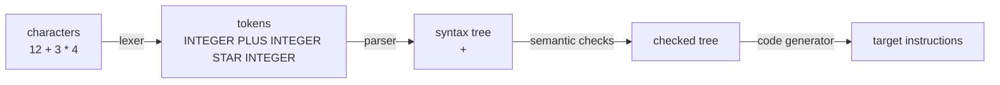
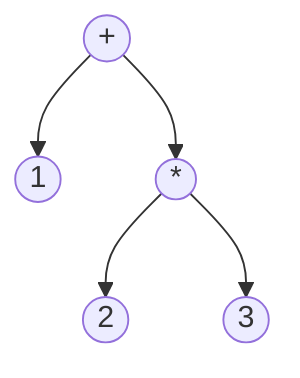

# Week 7 Lecture Notes — Expression Parsing and Syntax Trees

> October 20, 2026 · Source lineage: previous syntax-tree, computer, and
> assembly notes, the 2025 Week 4–5 compiler notebooks, and the
> instructor-provided *From C to Assembly* handout

> Python bridge: [Python Contrast Companion for Week 7](week07_python_companion.md)

---

## Student route

- **Core:** trace characters to tokens to an AST, use the grammar to explain
  precedence, evaluate the tree, and release every owned node.
- **Practice:** the [Week 7 exercise](lecture_exercises/week07_ex.md) uses a
  complete starter. `parse_unary` is intentionally supplied for tracing and
  failure-injection; it is not a TODO.
- **Complete references:** both the starter and [complete example](examples.c)
  compile; use the example only when a lecture fragment omits supporting code.
- **Python bridge:** use the companion when parser structure is clearer without
  C ownership details, then return to the C lifetime contracts.

---

## Learning objectives

By the end of this lecture, you should be able to:

1. Separate lexical analysis, parsing, semantic analysis, and code generation.
2. Write an unambiguous expression grammar with precedence and associativity.
3. Implement a recursive-descent parser that produces an AST.
4. Evaluate and release an AST safely.
5. Connect AST structure to stack-machine code generation.

---

## Three-hour plan

| Hour | Main question | In-class production |
|------|---------------|---------------------|
| 1 | How do characters become a trustworthy token stream? | Complete and test a position-aware lexer |
| 2 | How does grammar become an owning syntax tree? | Trace one precedence level and audit its failure cleanup |
| 3 | How does tree meaning become checked instructions? | Add semantic checks, generate code, and test end to end |

Each hour alternates explanation, hand traces, live coding, and short practice.
Exercises labelled **Core live** belong to the planned classroom route.
Exercises labelled **Extension** may move to the asynchronous project work or
independent study when the class needs more time for the core pipeline.

### Inline practice routine

For each **Try it now** activity:

1. predict the token sequence, parser state, tree shape, value, diagnostic, or
   instruction trace before running code;
2. name the pipeline stage and the owner of every allocated subtree involved;
3. compile valid C with `-std=c17 -Wall -Wextra -Wpedantic` when the activity
   asks for a code change;
4. compare the observed result with the expected output or trace; and
5. expand **Reveal solution** only after recording an attempt.

Every solution states whether its text is program output, a conceptual trace,
or a description of a fragment that performs no input/output. Exact allocation
addresses and sanitizer wording are machine-dependent and are not required.

- **Core live:** part of the planned in-class route.
- **Extension:** additional practice for project work or later review.

The core-live activities total about 18 minutes in Hour 1, 23 minutes in Hour
2, and 15 minutes in Hour 3. The remaining time is for explanation, live
coding, questions, transitions, and a short break.

---

## Hour 1 — Compiler stages and lexical analysis

> **Hour 1 route:** [A small compiler is a pipeline](#1-a-small-compiler-is-a-pipeline)
> → [Tokens](#2-tokens)
> → [A lexer skeleton](#a-lexer-skeleton)
> → [lexer lab](#hour-1-lexer-lab)

> **Project application:** a compiler is not a fundamental C-language feature.
> This week deliberately integrates strings, tagged data, pointers, recursion,
> trees, ownership, and testing in the midterm-project domain.

### 1. A small compiler is a pipeline



Each stage gives a simpler contract to the next:

- **Lexer:** groups characters into tokens such as integers and operators.
- **Parser:** checks grammatical structure and builds an abstract syntax tree.
- **Semantic analysis:** checks rules not captured conveniently by the grammar.
- **Code generation:** emits instructions that implement the tree's meaning.

Do not make every function inspect raw input. Good intermediate representations
localize errors and make stages testable independently.

The diagram is a conceptual data-flow trace, not program output.

#### Try it now [Core live] — assign one responsibility per stage (4 minutes)

For the source `12 + 3 * )`, state the first useful fact that each stage can
contribute. Which stage should report the unmatched `)` in this grammar, and
why should the code generator never receive this input?

<details>
<summary>Reveal solution</summary>

- The lexer produces valid tokens: integer `12`, plus, integer `3`, star,
  right parenthesis, and end.
- The parser accepts the left operand of `*` but cannot parse a unary or primary
  expression beginning with `)`. It reports the structural error.
- Semantic analysis and code generation do not run because no complete AST was
  produced.

The character `)` is lexically valid, so rejecting it in the lexer would mix
token recognition with grammatical context. This is a pipeline trace; it has
no run-time output.

</details>

---

### 2. Tokens

```c
#include <stddef.h>

enum TokenKind {
  TOKEN_INTEGER,
  TOKEN_PLUS,
  TOKEN_MINUS,
  TOKEN_STAR,
  TOKEN_SLASH,
  TOKEN_LEFT_PAREN,
  TOKEN_RIGHT_PAREN,
  TOKEN_END,
  TOKEN_INVALID
};

struct Token {
  enum TokenKind kind;
  long value;
  size_t position;
};
```

The lexer should always make progress: consume a valid token, skip permitted
whitespace, or consume/report an invalid character. Recording the source
position makes later diagnostics precise.

The complete teaching example intentionally parses numeric expressions only.
The project adds identifiers and more operators using the same pipeline. Keeping
the teaching language small lets us see every ownership and error path.

These declarations define data representations and produce no run-time output.

#### Try it now [Core live] — distinguish kind, value, and position (4 minutes)

Suppose the lexer reads the source ` 42+7`. Write the three fields of the first
three non-end tokens. Which field is meaningful for every token, and which
field is meaningful only for `TOKEN_INTEGER`?

<details>
<summary>Reveal solution</summary>

| Lexeme | `kind` | `value` | `position` |
|--------|--------|---------|------------|
| `42` | `TOKEN_INTEGER` | `42` | `1` |
| `+` | `TOKEN_PLUS` | unused (`0` in the complete example) | `3` |
| `7` | `TOKEN_INTEGER` | `7` | `4` |

`kind` and `position` are meaningful for every token. `value` carries source
meaning only for an integer token. The table is a predicted token trace; the
declarations themselves print nothing.

</details>

---

### A lexer skeleton

```c
struct Lexer {
  const char* input;
  size_t position;
};

static char peek(const struct Lexer* lexer) {
  return lexer->input[lexer->position];
}

static char take(struct Lexer* lexer) {
  char current = peek(lexer);
  if (current != '\0') ++lexer->position;
  return current;
}
```

A token carries the starting position, kind, and parsed value. Integer scanning
must detect overflow while accumulating rather than after overflow has occurred:

```c
#include <ctype.h>
#include <limits.h>

long value = 0;
while (isdigit((unsigned char)peek(lexer))) {
  int digit = take(lexer) - '0';
  if (value > (LONG_MAX - digit) / 10) {
    return token_invalid(start);
  }
  value = value * 10 + digit;
}
```

Cast to `unsigned char` before calling `<ctype.h>` classification functions;
passing a negative plain `char` other than `EOF` is undefined behavior.

Neither the `peek`/`take` helpers nor the integer-scanning fragment prints
anything. A test driver must display returned tokens if a visible trace is
wanted.

The declarations above and all helper definitions appear together in the
[complete Week 7 example](examples.c). The
[starter file](lecture_exercises/week07_starter.c) uses the same `TokenKind`,
`Token`, `Lexer`, `AstKind`, `Ast`, and `Parser` types. It supplies the lexer,
AST construction and destruction, higher-precedence parser functions,
evaluation, tree printing, and a test `main`. Its `parse_unary` is a worked
implementation for tracing and failure-injection rather than an undisclosed
exercise answer. Lecture fragments below focus on one idea at a time; use the
complete example when you need a second compilable reference rather than
guessing an omitted helper.

---

### Hour 1 lexer lab

#### Try it now [Core live] — make progress visible (10 minutes)

For input `" 12 + 3*(4 - 1)"`, write every token with `[start,end)`, kind, and
value or lexeme. Then predict the behavior for empty input, `LONG_MAX`, one
integer one greater than `LONG_MAX`, the unsupported identifier in `"12 + x"`,
and repeated calls after end. In this teaching grammar, `x` is an invalid token
rather than an identifier.

<details>
<summary>Reveal solution</summary>

The complete token trace is:

| Range | Kind | Value or lexeme |
|-------|------|-----------------|
| `[1,3)` | `TOKEN_INTEGER` | `12` |
| `[4,5)` | `TOKEN_PLUS` | `+` |
| `[6,7)` | `TOKEN_INTEGER` | `3` |
| `[7,8)` | `TOKEN_STAR` | `*` |
| `[8,9)` | `TOKEN_LEFT_PAREN` | `(` |
| `[9,10)` | `TOKEN_INTEGER` | `4` |
| `[11,12)` | `TOKEN_MINUS` | `-` |
| `[13,14)` | `TOKEN_INTEGER` | `1` |
| `[14,15)` | `TOKEN_RIGHT_PAREN` | `)` |
| `[15,15)` | `TOKEN_END` | end of input |

- Empty input immediately returns `TOKEN_END` at position `0`.
- The decimal representation of `LONG_MAX` is one valid integer token.
- A decimal integer one greater than `LONG_MAX` becomes `TOKEN_INVALID`; the
  lexer consumes the remaining digits so it still makes progress.
- In `12 + x`, the `x` becomes `TOKEN_INVALID` at position `5`.
- Calls made after end keep returning `TOKEN_END` at the unchanged end
  position.

This table is the expected lexer trace. The lexer itself returns tokens and
does not print them. The parser should never inspect raw characters or repeat
the overflow logic.

</details>

---

## Hour 2 — Precedence grammar, recursive descent, and AST ownership

> **Hour 2 route:** [Grammar encodes precedence](#3-grammar-encodes-precedence)
> → [AST representation](#4-ast-representation)
> → [Parser state and errors](#5-parser-state-and-errors)
> → [Recursive descent](#6-recursive-descent)
> → [Precedence trace](#precedence-trace)
> → [AST constructors centralize invariants](#ast-constructors-centralize-invariants)
> → [guided trace and controlled modification](#hour-2-guided-trace-and-controlled-modification)

### 3. Grammar encodes precedence

This grammar makes multiplication bind tighter than addition and makes binary
operators left-associative:

```text
expression  -> term (('+' | '-') term)*
term        -> unary (('*' | '/') unary)*
unary       -> ('+' | '-') unary | primary
primary     -> INTEGER | '(' expression ')'
```

Read the notation before reading parser code:

- `name -> form` means “the construct on the left may have the form on the
  right.”
- `|` separates alternatives; it does not mean C's bitwise-or operator here.
- Parentheses group grammar symbols.
- A trailing `*` means “repeat the grouped form zero or more times”; it is not
  multiplication or pointer dereferencing.
- Uppercase `INTEGER` names a token produced by the lexer. Lowercase names such
  as `term` name other grammar rules.

For example, `8 - 3 - 2` starts with one `term`, then repeats `'-' term` twice.
The loop in `parse_expression` combines those repetitions from left to right,
producing `(8 - 3) - 2`.

An identifier extension would add an `IDENTIFIER` token and AST node to
`primary`, together with a lexical rule and an environment used during
evaluation. The core parser below deliberately implements only the grammar
shown here.

For `1 + 2 * 3`, `expression` contains one `term` for `1` and another whose
tree is `2 * 3`. For `8 - 3 - 2`, the repetition builds `(8 - 3) - 2`.

Grammar is executable design: one parser function corresponds to each
nonterminal.

The grammar description produces no run-time output; its observable result is
the tree shape built by the corresponding parser functions.

#### Try it now [Core live] — read precedence from the grammar (4 minutes)

Draw the ASTs for `1 + 2 * 3` and `8 - 3 - 2`. Then write each tree in the
prefix notation used by the Week 7 starter and predict its evaluated value.

<details>
<summary>Reveal solution</summary>

Multiplication is nested beneath addition because `term` handles `*` before
`expression` combines terms:

```text
source: 1 + 2 * 3
tree:   (+ 1 (* 2 3))
value:  7
```

The loop in `parse_expression` combines subtraction from left to right:

```text
source: 8 - 3 - 2
tree:   (- (- 8 3) 2)
value:  3
```

These are AST and evaluation traces. They become program output only when a
driver calls the tree printer and evaluator.

</details>

---

### 4. AST representation

```c
enum AstKind {
  AST_INTEGER,
  AST_ADD,
  AST_SUBTRACT,
  AST_MULTIPLY,
  AST_DIVIDE,
  AST_NEGATE
};

struct Ast {
  enum AstKind kind;
  long value;
  struct Ast* left;
  struct Ast* right;
};
```

Representation rules:

- `AST_INTEGER` stores its number in `value` and has no children.
- `AST_NEGATE` uses `left` as its operand and has no right child.
- Binary nodes own both child trees.

An AST omits punctuation that was required only to parse. Parentheses affect
shape but do not need their own nodes.

The type declarations themselves produce no run-time output.

#### Try it now [Extension] — check node invariants (4 minutes)

For each proposed node, decide whether it satisfies the representation rules:

1. `AST_INTEGER` with value `4` and no children;
2. `AST_NEGATE` with a left child and no right child;
3. `AST_ADD` with a left child but no right child; and
4. `AST_INTEGER` with a left child.

<details>
<summary>Reveal solution</summary>

The first two nodes are valid. The third is missing one owned operand, and the
fourth gives a number node a child it must not have. A constructor that enforces
these rules accepts cases 1 and 2 and rejects cases 3 and 4.

This is an invariant check, not program output. If a test driver printed only
acceptance results, an illustrative output would be `accept, accept, reject,
reject`.

</details>

---

### 5. Parser state and errors

```c
struct Parser {
  struct Lexer lexer;
  struct Token current;
  const char* error;
};

static void parser_advance(struct Parser* parser) {
  parser->current = lexer_next(&parser->lexer);
  if (parser->current.kind == TOKEN_INVALID && parser->error == NULL) {
    parser->error = "invalid token or integer overflow";
  }
}
```

Every parser function follows a useful contract:

- on success, return an owned AST and leave `current` at the first unused token;
- on failure, return `NULL`, record one diagnostic, and release partial trees.

The top-level parse succeeds only if an expression is followed by `TOKEN_END`.
Accepting a valid prefix while ignoring trailing garbage is a parser bug.

The state declarations and `parser_advance` helper do not print. They update
`current`; diagnostics become visible only when a caller prints `error` and the
current token's position.

#### Try it now [Core live] — reject a valid prefix with trailing input (3 minutes)

Trace the top-level parser on `1 + 2 3`. What tree can `parse_expression`
temporarily build, which token remains unused, and what diagnostic does the
complete example print when run with this argument?

<details>
<summary>Reveal solution</summary>

`parse_expression` can build `(+ 1 2)`, but the integer token `3` remains at
position `6`. Because the first unused token is not `TOKEN_END`, the top-level
parser destroys the temporary tree and rejects the input.

**Expected diagnostic from `examples.c`:**

```text
parse error at 6: unexpected token after expression
```

The program writes this line to standard error and exits with failure.

</details>

---

### 6. Recursive descent

Simplified additive parsing:

```c
static struct Ast* parse_expression(struct Parser* parser) {
  struct Ast* left = parse_term(parser);
  if (left == NULL) return NULL;

  while (parser->current.kind == TOKEN_PLUS ||
         parser->current.kind == TOKEN_MINUS) {
    enum TokenKind operation = parser->current.kind;
    parser_advance(parser);

    struct Ast* right = parse_term(parser);
    if (right == NULL) {
      ast_destroy(left);
      return NULL;
    }

    enum AstKind kind = operation == TOKEN_PLUS ? AST_ADD : AST_SUBTRACT;
    struct Ast* combined = ast_create(kind, 0, left, right);
    if (combined == NULL) {
      ast_destroy(left);
      ast_destroy(right);
      return NULL;
    }
    left = combined;
  }
  return left;
}
```

Updating `left` after each operator creates left association. Notice the
failure paths: every successfully constructed subtree has exactly one owner.

The function returns an owned AST or `NULL`; it produces no direct output.

#### Try it now [Core live] — follow the accumulating left subtree (4 minutes)

For `8 - 3 - 2`, record the tree owned by `left` immediately after the initial
`parse_term` and after each loop iteration. If parsing the final right operand
failed instead, which subtree would this function destroy?

<details>
<summary>Reveal solution</summary>

```text
after initial term:       8
after first subtraction:  (- 8 3)
after second subtraction: (- (- 8 3) 2)
```

At every point, `left` owns the complete tree built so far. If a later right
operand fails, `parse_expression` destroys that entire `left` tree before
returning `NULL`. This is an ownership trace; the function itself prints
nothing. The starter's tree printer displays the final tree as
`(- (- 8 3) 2)`.

</details>

---

### Precedence trace

#### Try it now [Core live] — expand the parser call trace (5 minutes)

Trace `-2 * (3 + 4) - 5`. For the outer calls to `parse_unary`, `parse_term`,
and `parse_expression`, record the token on entry, returned subtree, and first
unused token. Draw the final owned tree and predict its value.

<details>
<summary>Reveal solution</summary>

| Function | Token on entry | Result on return | First unused token |
|----------|----------------|------------------|--------------------|
| `parse_primary` for `2` | `2` | `2` | `*` |
| outer `parse_unary` | first `-` | `(neg 2)` | `*` |
| outer `parse_term` | first `-` | `(* (neg 2) (+ 3 4))` | second `-` |
| outer `parse_expression` | first `-` | `(- (* (neg 2) (+ 3 4)) 5)` | end |

```text
        (-)
       /   \
     (*)    5
    /   \
 (neg)  (+)
   |    / \
   2   3   4
```

The evaluation trace computes `3 + 4 = 7`, negates `2`, multiplies to obtain
`-14`, and subtracts `5`, producing `-19`. Unary minus is therefore syntax, not
part of the integer token. This table and diagram are conceptual traces; a
driver that prints only the value would output `-19`.

</details>

---

### AST constructors centralize invariants

```c
#include <stdlib.h>

static struct Ast* ast_create(enum AstKind kind, long value, struct Ast* left,
                              struct Ast* right) {
  int is_number = kind == AST_INTEGER && left == NULL && right == NULL;
  int is_unary = kind == AST_NEGATE && left != NULL && right == NULL;
  int is_binary =
      (kind == AST_ADD || kind == AST_SUBTRACT || kind == AST_MULTIPLY ||
       kind == AST_DIVIDE) &&
      left != NULL && right != NULL;
  if (!is_number && !is_unary && !is_binary) return NULL;

  struct Ast* node = malloc(sizeof(*node));
  if (node == NULL) return NULL;
  node->kind = kind;
  node->value = value;
  node->left = left;
  node->right = right;
  return node;
}
```

This constructor performs no input/output. Its observable effects are either a
new allocation returned to the caller or `NULL` with child ownership unchanged.

Define whether ownership transfers only on success or whenever nonnull children
are passed. `ast_create` transfers ownership only when it succeeds; on failure,
the parser destroys both children itself. A mismatched convention causes leaks
or double free.

#### Try it now [Extension] — decide who owns the children (3 minutes)

Assume `left` and `right` are valid owned subtrees. For each call below, state
whether the shape is valid and who owns the children after success or failure:

```c
ast_create(AST_ADD, 0, left, right);
ast_create(AST_NEGATE, 0, left, right);
```

<details>
<summary>Reveal solution</summary>

- The `AST_ADD` shape is valid. On successful allocation, the returned parent
  owns both children. On allocation failure, the caller still owns both and
  must destroy them.
- The `AST_NEGATE` shape is invalid because a negate node must have no right
  child. The function returns `NULL` without taking either child; the caller
  still owns both.

There is no normal program output. A memory checker should also be silent when
the caller follows this ownership contract.

</details>

`parse_primary` handles integers and parenthesized expressions:

```c
static struct Ast* parse_primary(struct Parser* parser) {
  if (parser->current.kind == TOKEN_INTEGER) {
    long value = parser->current.value;
    parser_advance(parser);
    return ast_create(AST_INTEGER, value, NULL, NULL);
  }

  if (parser->current.kind == TOKEN_LEFT_PAREN) {
    parser_advance(parser);
    struct Ast* inside = parse_expression(parser);
    if (inside == NULL) return NULL;
    if (parser->current.kind != TOKEN_RIGHT_PAREN) {
      parser->error = "expected ')'";
      ast_destroy(inside);
      return NULL;
    }
    parser_advance(parser);
    return inside;
  }

  if (parser->error == NULL) {
    parser->error = "expected an integer or '('";
  }
  return NULL;
}
```

`parse_primary` returns a subtree or `NULL`; it does not print its diagnostic.
The top-level driver is responsible for displaying the stored error.

#### Try it now [Extension] — clean up a missing parenthesis (4 minutes)

Trace `parse_primary` for `(2 + 3`. At what position is the error detected,
what partial tree exists at that moment, and who releases it?

<details>
<summary>Reveal solution</summary>

The recursive expression parse successfully builds `(+ 2 3)`. The next token
is `TOKEN_END` at position `6`, where `parse_primary` expected `)`. It records
the error, destroys the `inside` tree, and returns `NULL`.

**Expected diagnostic from `examples.c`:**

```text
parse error at 6: expected ')'
```

The diagnostic is standard-error output. A sanitizer run should add no leak or
invalid-access report.

</details>

---

### Hour 2 guided trace and controlled modification

#### Try it now [Core live] — trace unary recursion and cleanup (7 minutes)

The starter supplies a complete `parse_unary` implementation. Do not rewrite it
as a hidden TODO. Trace how it implements
`unary -> ('+' | '-') unary | primary` for `+5`, `-5`, `--5`, and
`-(2 + 3)`. For every recursive call, record the current token and the owner of
the returned subtree. What must happen if creating an `AST_NEGATE` node fails?

Then inject a construction failure, run a memory checker, explain its evidence,
and restore the correct code. Use malformed cases to inspect existing cleanup
paths: `1 +`, `2 * )`, `(3 + 4`, and an incomplete `-`.

<details>
<summary>Reveal solution</summary>

| Source | Returned tree | Value |
|--------|---------------|-------|
| `+5` | `5` | `5` |
| `-5` | `(neg 5)` | `-5` |
| `--5` | `(neg (neg 5))` | `5` |
| `-(2 + 3)` | `(neg (+ 2 3))` | `-5` |

Unary plus passes through the recursive call's owned result. Each unary minus
temporarily owns its operand; successful construction transfers that ownership
to the new negate node. If construction fails, `parse_unary` must destroy the
operand before returning `NULL`.

The malformed inputs are all rejected. The incomplete `-` reaches
`TOKEN_END` at position `1` and records `expected an integer or '('`. Exact
memory-checker wording depends on the tool, but the restored implementation
must finish with no leak or invalid-access diagnostic. The table is a tree and
value trace; the parser functions themselves print nothing.

</details>

---

## Hour 3 — Semantics, evaluation, and code generation

> **Hour 3 route:** [Evaluation is postorder](#7-evaluation-is-postorder)
> → [Semantic checks are not parsing](#semantic-checks-are-not-parsing)
> → [From tree to instructions](#8-from-tree-to-instructions)
> → [Register pressure and evaluation order](#register-pressure-and-evaluation-order)
> → [Differential testing and demo rehearsal](#differential-testing-and-demo-rehearsal)
> → [Test stages independently](#9-test-stages-independently)

### 7. Evaluation is postorder

Week 6 introduced postorder on ordinary binary trees. An expression tree adds
one invariant: number nodes have no children, a negation node owns one child,
and a binary operator owns two children. For `1 + 2 * 3`, precedence produces:



Postorder visits `1, 2, 3, *, +`. Each operator runs only after the values of
its children are available.

```c
int ast_evaluate(const struct Ast* node, long* result) {
  if (node->kind == AST_INTEGER) {
    *result = node->value;
    return 1;
  }

  long left;
  long right;
  if (!ast_evaluate(node->left, &left)) return 0;
  if (node->kind == AST_NEGATE) {
    *result = -left;
    return 1;
  }
  if (!ast_evaluate(node->right, &right)) return 0;

  switch (node->kind) {
    case AST_ADD:
      *result = left + right;
      return 1;
    case AST_SUBTRACT:
      *result = left - right;
      return 1;
    case AST_MULTIPLY:
      *result = left * right;
      return 1;
    case AST_DIVIDE:
      if (right == 0) return 0;
      *result = left / right;
      return 1;
    default:
      return 0;
  }
}
```

This pedagogical fragment returns a success flag and writes through `result`;
it prints nothing by itself. A caller decides whether to print the value or an
evaluation diagnostic.

Production code must also define and check overflow behavior. The complete
example rejects arithmetic overflow; the shorter fragment keeps the traversal
visible. Semantic analysis can reject invalid constructs before code generation.
This evaluator fragment covers the lecture's numeric trees. When the project
adds identifier nodes, evaluation requires an environment that maps each
identifier to its current value.

#### Try it now [Core live] — evaluate only after the children (4 minutes)

Write the recursive visit and operation order for `1 + 2 * 3`. Then trace
`8 / (3 - 3)` and identify the exact node that reports failure.

<details>
<summary>Reveal solution</summary>

For `1 + 2 * 3`, postorder visits and computes:

```text
integer 1 -> integer 2 -> integer 3 -> multiply -> add
2 * 3 = 6
1 + 6 = 7
```

For `8 / (3 - 3)`, the subtraction succeeds with `0`; the divide node then
detects a zero right operand and returns failure. Its ancestors, if any, must
propagate that failure without using an unwritten result.

The evaluator itself produces no output. A simple driver could print `7` for
the first tree and `evaluation error` for the second.

</details>

---

### Semantic checks are not parsing

The grammar can accept forms whose meaning is invalid. In the project compiler,
increment/decrement or assignment-like operations require a modifiable variable
rather than an arbitrary expression. Keep this rule in a separate semantic
function such as `is_modifiable`. After the project adds identifier nodes, that
function returns true exactly for the node kinds the specification defines as
modifiable. It must reject a number, a binary result, and any other temporary
expression.

An AST retains enough structure to report “left operand is not modifiable” at
the operator position. Do not twist the grammar until it rejects every
context-sensitive rule.

#### Try it now [Core live] — separate syntax from meaning (3 minutes)

Assume the project extension has identifier, addition, and assignment nodes.
Classify `x = 3`, `(x + 1) = 3`, and `7 = 3` as grammatically shaped expressions
and then as semantically valid or invalid assignment targets.

<details>
<summary>Reveal solution</summary>

All three can be represented by a permissive expression grammar. Semantic
analysis accepts `x = 3` because the left subtree names modifiable storage. It
rejects `(x + 1) = 3` because the addition produces a temporary value, and it
rejects `7 = 3` because an integer literal is not modifiable.

This is a semantic classification trace, not output from the numeric teaching
parser, which intentionally has no identifiers or assignment node.

</details>

---

### 8. From tree to instructions

#### Real assembly and the teaching target

A native compiler and this course's mini compiler solve the same broad lowering
problem but target different contracts. Native assembly commonly includes
register-to-register or register-to-memory transfers, arithmetic instructions,
labels and conditional jumps, and an ABI for calls and returns. Structured C
such as `if (value > 3)` may become a comparison followed by a jump that skips
the body when the condition is false; the compiler need not preserve the
source's positive wording.

The project target is a deliberately smaller simulated instruction set. Its
specification, register count, memory model, side-effect order, and cycle rules
are authoritative. Do not emit an x86 instruction just because it appeared in
the native assembly for similar C, and do not infer that the simulator follows
the host machine's calling convention.

Use native C-to-assembly output as a comparison exercise: identify loads,
stores, arithmetic, comparisons, branches, labels, calls, and returns. Then map
the same source behavior to the project target one semantic step at a time.
This separates the portable behavior being compiled from one machine's encoding.

For a simple stack machine, generate the left subtree, then the right subtree,
then the operation:

```text
AST:       (+)
          /   \
         1    (*)
             /   \
            2     3

PUSH 1
PUSH 2
PUSH 3
MUL
ADD
```

This is postorder traversal. A register machine adds a resource-allocation
problem: which temporary register holds each intermediate result? The midterm
project's hidden tests check language behavior, but the demo checks whether you
can connect emitted instructions back to AST structure.

#### Try it now [Core live] — lower a tree to stack instructions (4 minutes)

Emit stack-machine instructions for `(8 - 3) / 5`. After every instruction,
write the stack from bottom to top and predict the final value.

<details>
<summary>Reveal solution</summary>

| Instruction | Stack afterward |
|-------------|-----------------|
| `PUSH 8` | `8` |
| `PUSH 3` | `8, 3` |
| `SUB` | `5` |
| `PUSH 5` | `5, 5` |
| `DIV` | `1` |

**Generated instruction trace:**

```text
PUSH 8
PUSH 3
SUB
PUSH 5
DIV
```

The instructions are generated output. Executing them in the described stack
machine leaves the value `1` on the stack.

</details>

---

### Register pressure and evaluation order

> **Optional compiler extension:** first generate correct instructions for the
> teaching target. Register-demand heuristics and spilling are advanced code-
> generation concerns unless the project specification explicitly requires
> them.

For a target with a small fixed register set, annotate every subtree with the
number of registers required without spilling. A useful heuristic evaluates the
more demanding subtree first. If both results cannot remain in registers, emit
a store to temporary memory and reload it later.

For each instruction, maintain an invariant describing where the subexpression
value resides. Optimization must preserve that invariant and observable side
effects; fewer cycles are irrelevant if evaluation order becomes incorrect.

---

### Differential testing and demo rehearsal

> **Supporting testing technique:** the required skill is comparing two
> implementations on deliberate cases. Automated generation and round-trip
> properties are useful extensions after the ordinary unit tests pass.

Execute each AST in two ways: direct evaluation and generated code in the ASMC
simulator. Generate many small valid expressions and compare results, then keep
separate expected-failure tests for syntax, semantics, division by zero, and
resource exhaustion.

For rehearsal, a student should tokenize one expression, draw its AST, identify
owned allocations, explain semantic acceptance, predict instructions, make one
small live change, and add a test that fails without the change.

#### Try it now [Core live] — build a differential test table (4 minutes)

For `8 - 3 - 2`, `1 / 0`, and `1 +`, state what the parser, direct evaluator,
and generated-program runner should report. Which comparisons are meaningful?

<details>
<summary>Reveal solution</summary>

| Source | Parser | Direct evaluator | Generated program |
|--------|--------|------------------|-------------------|
| `8 - 3 - 2` | accept `(- (- 8 3) 2)` | value `3` | value `3` |
| `1 / 0` | accept | evaluation error | matching run-time error |
| `1 +` | reject | not run | not generated |

Compare values only after both executions succeed, and compare failure
categories when the language defines corresponding run-time errors. A rejected
parse has no AST, so neither evaluation nor generation is meaningful. This is
an expected-results table, not literal output from one program.

</details>

---

### 9. Test stages independently

- Lexer: whitespace, multi-digit integers, each operator, invalid characters.
- Parser: precedence, associativity, parentheses, unary chains, missing tokens.
- Semantics: invalid update targets and other rules that can be decided from
  the parsed program alone, as specified. Division by a compile-time-known zero
  may belong here if the language specification rejects it statically;
  otherwise division by zero is an evaluator or generated-program run-time
  error.
- Generator: smallest tree for every node kind and nested combinations.
- End to end: compare interpreter and generated-code results.

Property idea: pretty-print an AST with sufficient parentheses, parse it again,
and compare evaluation results.

---

## Midterm project handoff — Integrate against the real contracts

The lecture's small grammar and stack-machine example teach the pipeline, but
the project specification is authoritative. Before implementation, write its
exact precedence levels, associativity, prefix/postfix behavior, lvalue rules,
variable-memory mapping, and target-instruction constraints. Do not silently
substitute the lecture grammar or instruction model.

Verification should proceed stage by stage:

1. compare token sequences with the source text;
2. print or hand-trace AST shapes for precedence and associativity cases;
3. test valid and invalid increment/decrement operands;
4. trace side effects and evaluation order before emitting instructions;
5. run generated instructions with ASMC and compare final values with an
   independent oracle where the language subset permits it;
6. run valid and rejected inputs under sanitizers;
7. optimize instruction cycles only after all correctness evidence passes.

Use AI for counterexamples, trace review, and diagnosis. If it proposes code,
require it to name the grammar production and ownership contract being
implemented, then verify those claims manually. The demo may ask for an
AI-free explanation or a small modification in any of these stages.

Because Thursday is Midterm 1, the asynchronous checkpoint covers a bounded
stage-gate plan and representative traces rather than a scheduled integration
lab. Week 7 material is excluded from the exam. Complete the remaining parser,
semantic, code-generation, and verification gates incrementally before the
Week 10 demo.

---

## Check yourself

1. Draw the AST for `-1 + 2 * (3 - 4)`.
2. Why does the grammar use a loop for left-associative binary operators?
3. Where must a partial tree be freed when the right operand fails to parse?
4. Why must the top-level parser require `TOKEN_END`?
5. Emit stack-machine instructions for `6 / (1 + 2) + 4`.

<details>
<summary>Reveal solutions</summary>

1. Prefix form: `(+ (neg 1) (* 2 (- 3 4)))`. Its value is `-3`.
2. Each iteration combines the accumulated left subtree with the next right
   operand, producing `(a - b) - c` rather than `a - (b - c)`.
3. The parser function that owns the accumulated left subtree must destroy it
   before propagating failure. Any right-side function must similarly clean up
   allocations it has not transferred.
4. Without the end check, a valid prefix such as `1 + 2` could be accepted from
   the invalid complete input `1 + 2 3`.
5. The instruction trace is:

   ```text
   PUSH 6
   PUSH 1
   PUSH 2
   ADD
   DIV
   PUSH 4
   ADD
   ```

   It leaves `6` on the stack.

Items 1–4 are conceptual traces and explanations. Item 5 is generated output;
executing it produces the final stack value described above.

</details>

---

## Summary

- A compiler pipeline replaces one complicated task with testable stages.
- Grammar structure expresses precedence and associativity.
- Recursive-descent functions mirror grammar nonterminals.
- AST edges express ownership as well as syntax.
- Evaluation, destruction, and simple code generation are tree traversals.

---

## References and source materials

- [Instructor handout: *From C to Assembly*](../../assets/references/from_c_to_assembly.pdf)
- [Instructor slides: *Assembly*](../../assets/references/lee_assembly.pptx)
- [Syntax trees](<https://github.com/htchen/i2p-nthu/blob/master/程式設計二/mid1/5-syntax_tree.md>)
- [A simple computer model](<https://github.com/htchen/i2p-nthu/blob/master/程式設計二/mid1/6-Computer.md>)
- [Assembly language](<https://github.com/htchen/i2p-nthu/blob/master/程式設計二/mid1/7-Assembly.md>)
- [2025 Week 4, part 2 notebook (Colab)](https://colab.research.google.com/drive/1ELmeNLoaZT6f7DGXwAXbk72O83E2Hbn7)
- [2025 Week 5 notebook (Colab)](https://colab.research.google.com/drive/1cqxmTwoWv7E8g3sxzyEPYNL9a0K1fnfb)
